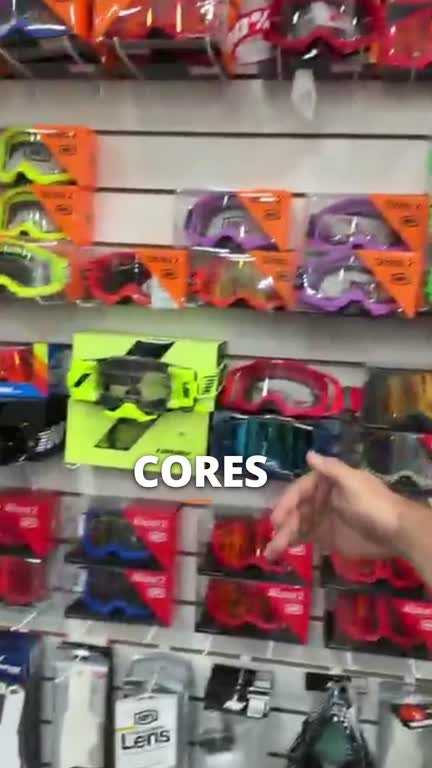

# Stories — óculos off road

Edição comercial de **44,8 segundos**, vertical **1080 × 1920**, com vídeo H.264 e áudio AAC. A voz original foi preservada, com limpeza leve. A edição inclui aproximações moderadas, palavras animadas sincronizadas com a fala e destaques próximos aos gestos.

## Vídeo pronto

[**Baixar o MP4 — aproximadamente 18 MB**](https://github.com/thalllys-blip/TalezeraDev/raw/refs/heads/main/videos/oculos-offroad-stories.mp4)

Abra o arquivo baixado no celular ou no computador para assistir. O MP4 também está na pasta [`videos`](videos/oculos-offroad-stories.mp4).



## Projeto editável

[**Baixar o projeto Remotion em ZIP — aproximadamente 22 MB**](https://github.com/thalllys-blip/TalezeraDev/raw/refs/heads/main/projeto/projeto-remotion-oculos.zip)

O ZIP inclui o código, o vídeo original, a voz tratada, as fontes, a transcrição automática, os tempos e os relatórios de validação.

Depois de extrair:

```bash
cd offroad-stories
npm ci
npm run dev
```

Selecione **Oculos-Stories** no Remotion Studio. A composição **Oculos-Original** conserva o vídeo de referência.

## Conferência

- Prévia aberta e conferida no Remotion Studio.
- 1344 quadros, 30 fps e 44,8 segundos; arquivo final decodificado sem erros.
- H.264, AAC, yuv420p, BT.709 e MP4 preparado para início rápido.
- Sincronização do áudio conferida em cinco pontos da linha do tempo.

A gravação original tem 464 × 832 pixels. A exportação amplia essa imagem; as aproximações ficam até 113%. Não foram acrescentados preços, nomes de modelos incertos, música, ícones ou logo.
